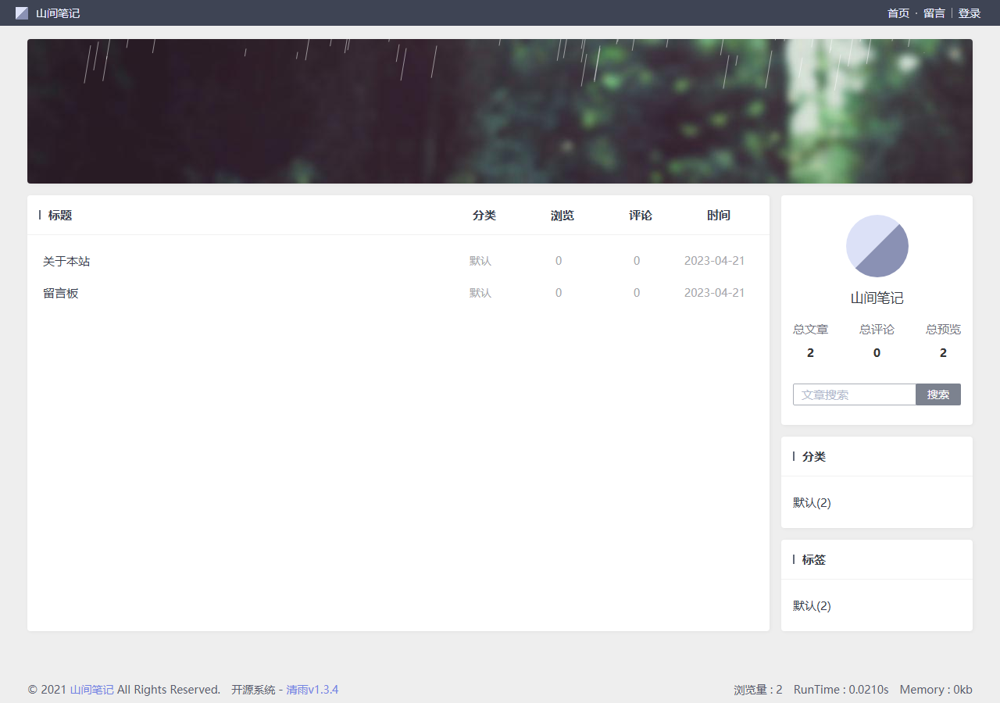

# Prain 清雨博客 · Cloudflare Workers 单站版

把 [prain.cn](https://prain.cn) 官方 **Prain 1.3.4** 完整移植到 Cloudflare Workers：
前台、后台、fk 标记语言、模板引擎、评论、上传、主题、扩展、安装向导全部保留，
数据落在 **D1 + KV**，不依赖 R2，也不需要 PHP 和服务器。

> 想开一个多租户博客平台（注册子域、运维面板）？看另一个项目：[YerinBlog-PrainPlat](https://github.com/FengHuaworker/YerinBlog-PrainPlat)



## 在线演示

https://prainblog.yerinblog.cc.cd

> 演示站只开放前台浏览，后台入口对访客返回 404。

## 功能

| 模块 | 原版 | 本移植 |
| --- | --- | --- |
| 首页 / 分类 / 标签 / 搜索 / 文章页 | ✅ | ✅ 路由与分页参数一致 |
| 评论（楼中楼、验证码、敏感词、灌水限制、每日上限） | ✅ | ✅ |
| 登录 / Token 校验 / 登录失败锁定 | ✅ | ✅ 签名 Cookie 会话 |
| 后台：首页 / 导航 / 分类 / 友链 / 文章 CRUD / 批量移动删除 | ✅ | ✅ |
| 网站设置、主题、扩展、错误日志 | ✅ | ✅ |
| `.sx` 应用包导入导出 | ✅ | ✅ 常见 PHP 模板自动转换 |
| fk 标记语言 | ✅ | ✅ 逐条移植 |
| 模板语法 `{$}` `{#}` `{{}}` `{if}` `{foreach}` `{include}` `{url}` hook | ✅ | ✅ 解释执行，不用 eval |
| 上传 | ✅ GD | ✅ KV；不生成缩略图 |
| 安装向导 | ✅ | ✅ |
| 检查更新 / 数据库版本同步 | ✅ | ✅ 读取 prain.cn API |
| 在线系统同步 | ✅ | ⚠️ 改为重新部署 |

## 快速开始

```bash
git clone https://github.com/FengHuaworker/Prain-for-CloudflareWorker.git
cd Prain-for-CloudflareWorker
npm install

npx wrangler login
npx wrangler d1 create prain
npx wrangler kv namespace create PRAIN_KV
```

把返回的两个 ID 填进 `wrangler.toml`：

```toml
[[d1_databases]]
binding = "DB"
database_name = "prain"
database_id = "REPLACE_WITH_YOUR_D1_DATABASE_ID"

[[kv_namespaces]]
binding = "KV"
id = "REPLACE_WITH_YOUR_KV_NAMESPACE_ID"
```

```bash
npx wrangler secret put SESSION_SECRET   # 建议：32 位以上随机串
npm run deploy
```

首次打开会自动建表，并进入安装向导（站点名、简介、后台密码）。

想绑自己的域名：Worker → Settings → Domains & Routes → Add custom domain。

## 本地开发

```bash
npm run dev        # http://127.0.0.1:8787
```

本地 D1 在 `.wrangler/<persist>/v3/d1`；可以用 `--persist-to .wrangler/a` 隔离多套测试数据。

## 数据

所有业务表都带 `site` 字段，单站模式固定为 `main`。这是为了和平台版共用同一套表结构，方便以后迁移。

- 备份：`npx wrangler d1 export prain --remote --output backup.sql`
- 上传文件在 KV，按 `site:main:upload:*` 前缀存放

## 与 PHP 版的差异

1. **不执行 PHP**：主题/扩展里的 PHP 逻辑不能跑；导入 `.sx` 时会把 `echo/if/foreach/include` 转成模板语法，其余标记 `<!-- unp: -->` 并在导入结果里报数量。
2. **缩略图**：Workers 没有 GD，`thumb_*` 不生成，`img` 存原图。
3. **在线系统同步**改为重新部署；`检查更新` 仍可查官网版本。
4. **官网应用中心**（账号/支付）改为本地导入导出 + 跳转 prain.cn。
5. **评论输出做了 HTML 转义**（原版直接输出，存在存储型 XSS）。
6. 密码哈希仍是 md5（兼容旧数据），新站建议之后换更强哈希。

## 目录

```
src/
├─ app.ts                入口 / 请求上下文 / 安装流程 / 静态资源
├─ routes/front.ts       前台
├─ routes/admin.ts       后台
├─ lib/                  D1 数据层、模板引擎、fk、会话、应用包、上传、验证码
└─ views/                默认主题与后台模板
public/                  CSS / JS / 图片 / 扩展脚本
schema.sql               D1 结构（首次请求自动执行）
```

## 许可

**GPL-3.0**（GNU General Public License v3.0），全文见 [LICENSE](LICENSE)。

本项目是 [prain.cn](https://prain.cn) 1.3.4 的衍生作品。上游采用 MIT 许可，其版权与许可声明保留在 [NOTICE](NOTICE) 中；MIT 部分仍可按 MIT 使用，整体以 GPL-3.0 分发。

主题、扩展与 `public/` 下的静态资源版权归原作者所有。
